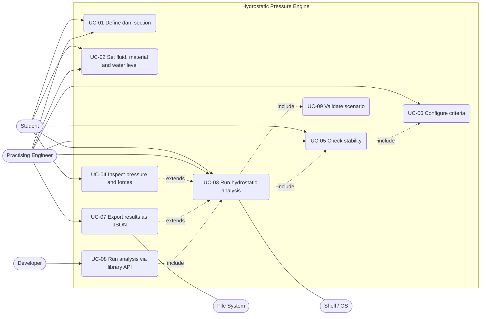

# 03 Actors and Use Cases

Status: APPROVED with owner-delegated decisions (Phase 3 gate), see section 7.
Inputs: `01-vision-stakeholders.md`, `02-requirements.md`.

## 1. Actors
| Actor | Type | Description | Stakeholder |
|-------|------|-------------|-------------|
| Student | Primary | Learns by defining a dam, running an analysis and reading intermediate values. Uses the CLI with JSON files. | S1 |
| Practising Engineer | Primary | Runs reproducible preliminary stability checks and keeps the JSON results as a record. Uses the CLI. | S2 |
| Developer | Primary | Calls the C++ library from another program or test; never touches the CLI. | S3 |
| File System | Secondary | Supplies scenario files and receives result files (or stdin/stdout). | - |
| Shell / OS | Secondary | Receives the CLI exit code and stderr. | - |

Deferred actors (not in v1): Instructor (S5), Visualization front end (a later consumer of the result data).

## 2. Use-case diagram

## 3. Use-case summary
| ID | Name | Primary actor | Requirements |
|----|------|---------------|--------------|
| UC-01 | Define dam section | Student, Engineer | FR-01, FR-02 |
| UC-02 | Set fluid, material and water level | Student, Engineer | FR-03, FR-04 |
| UC-03 | Run hydrostatic analysis | Student, Engineer | FR-05 to FR-11, FR-15, FR-17, FR-18 |
| UC-04 | Inspect pressure and forces | Student | FR-05 to FR-08, FR-11, FR-20, NFR-09 |
| UC-05 | Check stability | Student, Engineer | FR-09, FR-10, FR-12, FR-14 |
| UC-06 | Configure criteria | Engineer | FR-13 |
| UC-07 | Export results as JSON | Engineer | FR-17, FR-19 |
| UC-08 | Run analysis via library API | Developer | FR-16, NFR-04 |
| UC-09 | Validate scenario | (included by UC-03) | FR-02 to FR-04, NFR-10 |

## 4. Fully dressed use cases

### UC-01 Define dam section
- **Primary actor:** Student, Engineer. **Goal:** describe the cross-section geometry.
- **Preconditions:** none. **Trigger:** the actor writes the `dam.vertices` array of a scenario file.
- **Main flow:**
  1. Actor lists at least 3 vertices (x, y in metres), counter-clockwise, with the base on y = 0.
  2. Actor continues with UC-02.
- **Alternate flows:**
  - 1a. Actor gives a ready-made profile (rectangle or triangle) by listing its corner points; no special handling.
- **Error flows (detected in UC-09):** fewer than 3 vertices; self-intersecting polygon; zero area; no horizontal base edge on y = 0; vertex below y = 0; clockwise order (rejected, FR-02); NaN or infinite coordinates.
- **Postcondition:** a section candidate exists in the scenario; it is validated when the analysis runs.

### UC-02 Set fluid, material and water level
- **Primary actor:** Student, Engineer.
- **Preconditions:** UC-01 done (the crest height is needed to check the water level).
- **Main flow:**
  1. Actor sets `water_level_m`, `friction_angle_deg` and the load condition (usual, unusual, extreme).
  2. Actor optionally overrides fluid density, gravity, concrete unit weight and allowable bearing pressure.
  3. Omitted optional values take the defaults (1000 kg/m3, 9.81 m/s2, 23 500 N/m3).
- **Error flows:** non-positive density, gravity or unit weight; water level negative or above the crest (CON-04); friction angle outside (0, 90) degrees.
- **Postcondition:** a complete scenario ready to run.

### UC-03 Run hydrostatic analysis
- **Primary actor:** Student, Engineer. **Secondary:** Shell / OS.
- **Preconditions:** a scenario file exists. **Trigger:** actor runs the CLI with the scenario path.
- **Main flow:**
  1. CLI reads the scenario and the engine validates it (include UC-09).
  2. Engine computes water pressure on the wetted face and the resultant water force (FR-05, FR-06).
  3. Engine computes self-weight and centroid (FR-07).
  4. Engine combines the loads into the base resultant, contact length and base pressures (FR-08, FR-09).
  5. Engine computes the sliding FS and the informational overturning ratio with all terms (FR-10, FR-11).
  6. Engine evaluates the criteria (include UC-05) and attaches the uplift warning (FR-15).
  7. CLI writes the results (UC-07) and exits 0.
- **Alternate flows:**
  - 3a. Water level is 0: water load is zero; analysis continues and reports sliding as "no driving shear" (FR-10).
  - 5a. Resultant outside the base: the engine reports an unstable result with no valid contact; checks still produce a result, marked failed.
- **Error flows:** invalid scenario (UC-09 errors): CLI prints the message to stderr, writes no results, exits non-zero (FR-18). Malformed JSON or unknown `schema_version` (FR-19) behave the same way.
- **Postconditions:** results are available; the scenario is unchanged.

### UC-04 Inspect pressure and forces
- **Primary actor:** Student. **Goal:** understand how the answer was obtained.
- **Preconditions:** UC-03 completed successfully.
- **Main flow:**
  1. Actor opens the result file.
  2. Actor reads the pressure samples along the upstream face, the water force components and line of action, the self-weight and centroid.
  3. Actor reads each force with its lever arm and moment about the toe, tagged resisting or overturning (FR-11).
  4. Actor reproduces a number by hand from the documented formulas (NFR-09).
- **Alternate flows:** 2a. Actor requests more or fewer pressure samples via `pressure_samples` (FR-20).
- **Postcondition:** actor can trace every output to its inputs.

### UC-05 Check stability
- **Primary actor:** Student, Engineer. Included by UC-03.
- **Preconditions:** forces and base resultant computed.
- **Main flow:**
  1. Engine takes the thresholds for the chosen load condition (include UC-06).
  2. Engine compares the resultant location with the allowed zone (middle third, middle half, within base).
  3. Engine compares the sliding FS with the minimum.
  4. If an allowable bearing pressure was given, engine compares the maximum base pressure with it (FR-14).
  5. Engine records pass or fail per check with the computed value and the threshold, and an overall verdict (all checks must pass).
- **Alternate flows:** 4a. No allowable bearing given: the bearing check is reported as skipped, not as passed.
- **Postcondition:** each check has value, threshold and verdict; the overall verdict exists.

### UC-06 Configure criteria
- **Primary actor:** Engineer.
- **Main flow:**
  1. Actor selects the built-in preset (USACE EM 1110-2-2200 Table 4-1) or leaves the default.
  2. Actor optionally overrides the sliding FS minimum and the resultant zone for one or more load conditions.
- **Error flows:** sliding FS minimum not greater than 0; unknown zone name.
- **Postcondition:** criteria are fixed for the run and echoed in the results, so a result file records which criteria were applied.

### UC-07 Export results as JSON
- **Primary actor:** Engineer. **Secondary:** File System.
- **Main flow:**
  1. CLI serialises the result (all inputs echoed, intermediate values, checks, warnings, `schema_version`) with unit-suffixed keys.
  2. CLI writes to the output path or stdout.
- **Alternate flows:** 2a. Output path not writable: error to stderr, non-zero exit.
- **Postcondition:** the result file is self-describing and reproducible: running the engine on the echoed inputs gives the same result (NFR-03).

### UC-08 Run analysis via library API
- **Primary actor:** Developer.
- **Preconditions:** the library is built and linked.
- **Main flow:**
  1. Developer builds a `Scenario` value using strong unit types.
  2. Developer calls the analysis function (pure, no I/O, no global state; FR-16).
  3. Function returns a `Result` value holding either the analysis or a typed error (code and message); no exception is thrown (NFR-04).
  4. Developer reads the fields and decides what to do.
- **Alternate flows:** 3a. Invalid scenario: the error value is returned with the same codes the CLI reports.
- **Postcondition:** no files created, no state changed; calling twice with the same value gives the same result.

### UC-09 Validate scenario
- **Included by:** UC-03, UC-08.
- **Main flow:** the engine checks geometry (FR-02), parameters (FR-03, FR-04), finite and bounded numbers (NFR-10) and thresholds (UC-06), reporting the first or all errors.
- **Reporting:** all validation errors are collected and returned together (decision U1).

## 5. Scenarios
- **S-A (student, textbook case):** the AC-1 rectangle at full water level. UC-01, UC-02, UC-03, UC-04. Expected: fails usual criteria on location and sliding; student sees why from the moment table.
- **S-B (engineer, tuned design):** engineer adds a sloped downstream face to a trapezoidal profile until the usual-condition checks pass; reruns, keeps the JSON. UC-01 to UC-07.
- **S-C (developer, parametric sweep):** loop over water levels calling the library function, no files. UC-08.
- **S-D (error):** a clockwise polygon is rejected with the orientation message. UC-01, UC-09.

## 6. Traceability
Every M-priority FR and the NFRs appear in at least one use case above: FR-01, 02 -> UC-01, UC-09; FR-03, 04 -> UC-02; FR-05 to 11 -> UC-03, UC-04; FR-12, 14 -> UC-05; FR-13 -> UC-06; FR-15 -> UC-03; FR-16 -> UC-08; FR-17 to 19 -> UC-03, UC-07; NFR-03, 04 -> UC-07, UC-08; NFR-09 -> UC-04.

## 7. Gate decisions (owner delegated to assistant)
| # | Decision | Rationale |
|---|----------|-----------|
| U1 | Validation returns all errors at once (UC-09). | A user fixes a scenario file in one pass; validation is cheap and independent per field. Library returns a list of errors, the CLI prints each on its own line. |
| U2 | The result carries an overall verdict, FAIL if any check fails; each check still reports value, threshold and verdict. Skipped checks (e.g. no bearing allowable) do not fail the run but are listed as skipped. | A single clear answer for the engineer, with full detail for the student. Skipped is distinct from passed so nothing is silently implied. |
| U3 | Friction angle must be strictly between 0 and 90 degrees (UC-02). | At 0 the tool would give zero sliding resistance, and at 90 tan(phi) is unbounded; neither is physically meaningful for concrete on foundation. Real values are roughly 30 to 60 degrees. |
