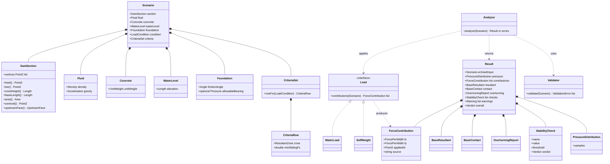
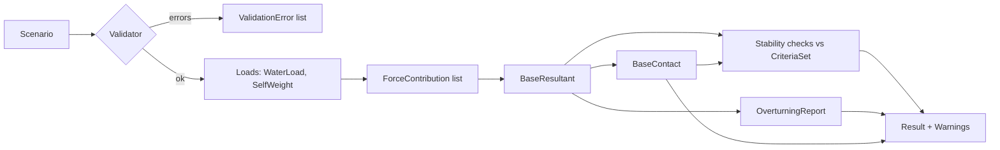

# 04 Domain Model

Status: APPROVED with owner decisions (Phase 4a gate), see section 9. The architecture (layers, interfaces, ADRs) follows in `05-architecture.md` after this gate.
Inputs: `02-requirements.md`, `03-use-cases.md`.
This document describes concepts and rules only. It does not fix C++ class layouts, which belong to the architecture phase.

## 1. Modelling approach
- **Value objects** are immutable, compared by value, and carry no identity (almost everything here).
- **Services** are stateless functions from values to values (analysis, validation).
- There are **no long-lived entities** in v1: one analysis is a pure function from a `Scenario` to a `Result` (FR-16). This keeps the engine deterministic and trivially testable.
- **Units are part of the model.** Every physical quantity has its own type (strong types, NFR-02).

## 2. Concept inventory
| Concept | Kind | Responsibility | Traces to |
|---------|------|----------------|-----------|
| Scenario | Value object (aggregate root of input) | Everything needed for one run: section, fluid, concrete, water level, foundation, criteria. | FR-01 to FR-04, FR-13, FR-14 |
| DamSection | Value object | CCW polygon of vertices; knows heel, toe, crest, base length, area, centroid, upstream face. | FR-01, FR-02, FR-07 |
| Point2 | Value object | A 2D point (Length x, Length y). | FR-01 |
| UpstreamFace | Derived value | The polyline from the heel to the crest on the water side. | FR-05, FR-06 |
| Fluid | Value object | Density, gravitational acceleration. | FR-03 |
| Concrete | Value object | Unit weight. | FR-03, FR-07 |
| WaterLevel | Value object | Elevation of the upstream water surface above the base. | FR-04 |
| Foundation | Value object | Friction angle, optional allowable bearing pressure (cohesion fixed at zero in v1). | FR-10, FR-14, CON-05 |
| CriteriaSet | Value object | Per load condition: resultant zone and minimum sliding FS. Presets: USACE Table 4-1. | FR-12, FR-13 |
| LoadCondition | Enumeration | Usual, Unusual, Extreme; selects which row of the CriteriaSet applies. | CON-06 |
| Load | Concept (interface in the architecture) | Something that produces force contributions on the dam. v1 implementations: WaterLoad, SelfWeight. Later: Uplift, Sediment, Ice, Seismic. | FR-21 (extension) |
| ForceContribution | Value object | One force: components (N per metre), application point, source name. The unit of hand-verification. | FR-06, FR-07, FR-11 |
| PressureDistribution | Value object | Pressure samples along the upstream face (position, pressure, normal direction). | FR-05, FR-20 |
| BaseResultant | Value object | Sum of vertical force V, sum of horizontal force H, total moment about the toe, location x_R from the toe, eccentricity e. | FR-08 |
| BaseContact | Value object | Contact length, heel and toe pressures, contact state (full, partial, none). | FR-09 |
| StabilityCheck | Value object | Name, computed value, threshold, verdict (pass, fail, skipped). | FR-10, FR-12, FR-14 |
| OverturningReport | Value object | Per-contribution lever arm and moment, tagged resisting or overturning, with the totals and the informational ratio. | FR-11 |
| Warning | Value object | Code and message, always including "uplift not modelled". | FR-15 |
| Result | Value object (aggregate root of output) | All of the above plus the echoed inputs and the overall verdict. | FR-16, UC-07 |
| ValidationError | Value object | Code, field path, message. Validation returns a list (decision U1). | FR-02, NFR-04 |
| Analyzer | Service | Scenario to Result (or list of ValidationError). The only entry point. | FR-16 |
| Validator | Service | Scenario to list of ValidationError. | UC-09 |

## 3. Class diagram

## 4. Analysis pipeline (data flow)

The key design choice is that **all loads become `ForceContribution` values** and everything downstream (resultant, overturning table, checks) works only on that list. Adding uplift later means adding one `Load` that emits contributions; nothing downstream changes. That is the extension seam promised in D3.

## 5. Conventions and derived quantities
- **Moment sign:** moments about the toe, counter-clockwise positive (x right/downstream, y up). With this convention the self-weight is **resisting** (positive) and the water force is **overturning** (negative). Resisting or overturning is derived from the sign of each contribution's moment, not stored.
- **Base resultant:** V = -sum(Fy) (downward positive), H = sum(Fx) (downstream positive), M = sum of moments about the toe.
  Location from the toe: x_R = M / V. Eccentricity from the base centre: e = B/2 - x_R.
- **Contact:** x_R in [B/3, 2B/3] gives full contact with pressures V/B * (1 +/- 6e/B). Otherwise, if 0 < x_R < B, contact length a = 3 x_R (when x_R < B/3) with a triangular distribution and peak 2V/a at the toe. If x_R is in (2B/3, B) the resultant lies on the heel side and the mirrored case applies, peak at the heel. If x_R <= 0 or x_R >= B, there is no valid contact.
- **Sliding:** FS = V tan(phi) / H, with cohesion zero (CON-05).
- **Exact integration:** water pressure is linear in elevation and the face is a polyline, so force and moment on each wetted segment are computed in closed form on the segment clipped at the water level. There is no numerical quadrature, which is what makes the 1e-9 tolerance (NFR-01) realistic.
- **Resultant zone check:** zone is a fraction of the base centred on the base centre (middle third = 1/3, middle half = 1/2, within base = 1). The check passes when x_R lies inside the zone.

## 6. Invariants
1. The section is a simple polygon with positive area, counter-clockwise, with exactly one edge on y = 0 that is horizontal; no vertex has y < 0.
2. Heel is the left end and toe the right end of the base edge; B > 0.
3. The upstream face is the boundary chain from the heel to the crest, and its elevation does not decrease along that chain. (New condition, see Q2 below.)
4. 0 <= water level <= crest height.
5. Density, gravity, unit weight > 0; friction angle strictly in (0, 90) degrees; all numbers finite.
6. `Result` is only produced for a valid `Scenario`, and echoes the exact inputs and criteria used.

## 7. Units required
Existing: `Length`, `Density`, `Acceleration`, `Pressure`. New: `Area` (m2), `UnitWeight` (N/m3), `Angle`, `ForcePerWidth` (N/m), `MomentPerWidth` (N*m/m, which dimensionally is N). All stay strong types. Because the analysis is per unit width, the force per width is dimensionally pressure x length, but see Q1.

## 8. Mapping to the existing skeleton
| Skeleton file | Domain concept | Note |
|---------------|----------------|------|
| `computation/units/*` | Unit types | Extend as in section 7. |
| `computation/math/Vector3.hpp` | Point2 / vector maths | v1 needs 2D only; see Q3. |
| `computation/materials/Fluid.hpp` | Fluid, Concrete | Concrete may move here as a second material type. |
| `computation/simulation/PressureField.*` | PressureDistribution | Rename to match, decided in the architecture phase. |
| `computation/simulation/HydrostaticModel.*` | Scenario, Loads | Likely split into Scenario and Load implementations. |
| `computation/simulation/Solver.*` | Analyzer | Single entry point. |
| `visualization/*` | out of scope in v1 | Reads `Result` only. |

## 9. Gate decisions (owner)
| # | Decision | Effect |
|---|----------|--------|
| M1 | `Pressure * Length` is allowed and returns `ForcePerWidth` (N/m); other nonsense combinations such as `Pressure / Length` stay deleted. | `Pressure.hpp` is changed in the units slice of Phase 6. Note: force per unit **width** (N/m) is the 2D quantity; force per **area** is pressure itself. |
| M2 | Upstream-face elevation must not decrease from heel to crest. | New validation rule; FR-02 amended in `02-requirements.md`. |
| M3 | v1 uses `Point2` / `Vector2`; `Vector3.hpp` stays a stub for later 3D work. | Physics kept in 2D for now. |
| M4 | `Concrete` is a separate value object from `Fluid`. | As in the class diagram. |
