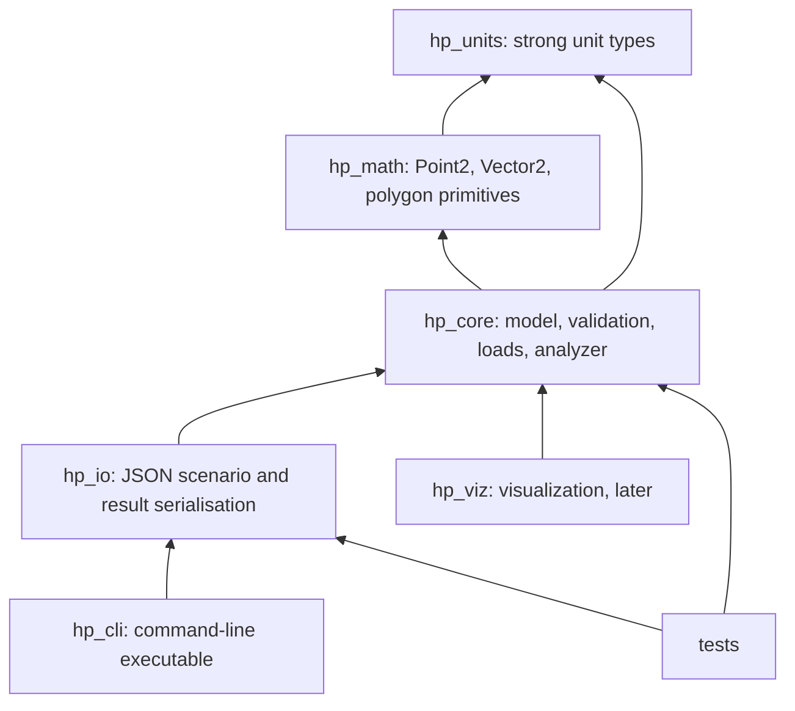
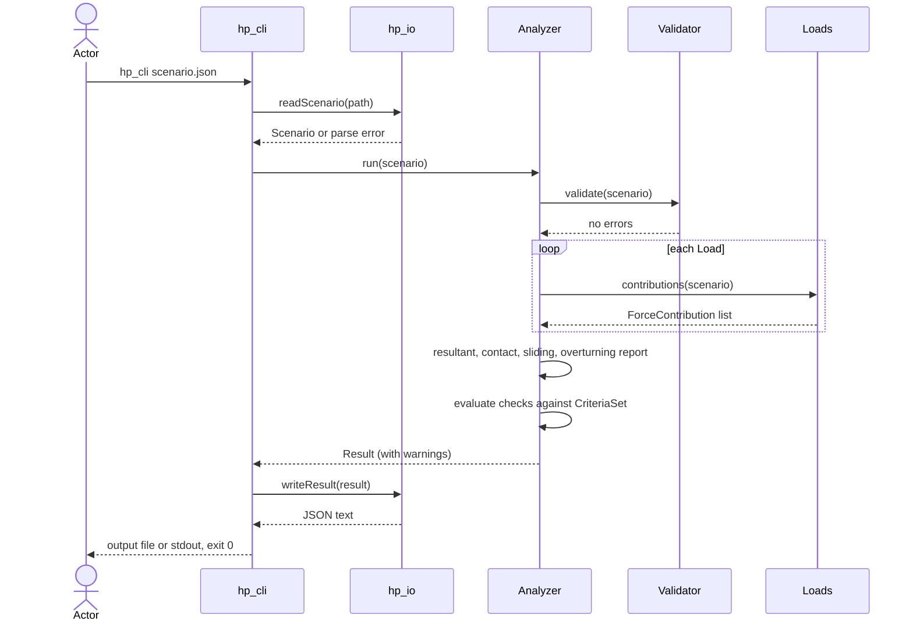

# 05 Architecture

Status: APPROVED (Phase 4b gate). ADRs 0001 to 0007 are ACCEPTED (ADR-0007, the numeric policy, was approved after S7).
Inputs: `02-requirements.md`, `03-use-cases.md`, `04-domain-model.md`.

## 1. Architectural drivers
| Driver | Source | Consequence |
|--------|--------|-------------|
| Trustworthy numbers, hand-verifiable | NFR-01, NFR-09, S2 | Closed-form integration, double precision, intermediate values in the result |
| Unit safety | NFR-02 | Strong unit types at every public boundary |
| Library first, no GUI dependency | D5, NFR-06 | Layered build targets; engine never includes I/O or visualization headers |
| No exceptions across the API | NFR-04 | Typed results (`std::expected`) |
| Deterministic, pure analysis | FR-16, NFR-03 | No global state, no I/O in the core, FP flags pinned |
| Extensible to uplift and hydrodynamics | D3, FR-21 | `Load` interface producing `ForceContribution` values |
| Testability of every requirement | NFR-07 | Small pure units; compile-fail tests for units |

## 2. Layers and build targets

Rules (enforced by CMake, since each target exposes only its own include directory and links only downward):
1. Dependencies point downward only. `hp_core` cannot include `hp_io`, `hp_cli` or `hp_viz` headers; they are not on its include path.
2. Only `hp_io` may use the JSON library. `hp_core` has no third-party dependency.
3. `hp_viz` depends on `hp_core`'s `Result` type only. It never calls back into the engine's internals.
4. Tests link against the layer they test.

## 3. Source layout
Existing directories are kept; new ones are marked.
```
computation/
  units/            Length, Density, Acceleration, Pressure (exist) + Area, UnitWeight, Angle, ForcePerWidth, MomentPerWidth
  math/             Point2, Vector2 (new); Vector3.hpp stays a stub
  materials/        Fluid.hpp (exists), Concrete.hpp (new)
  model/            (new) Scenario, DamSection, Foundation, CriteriaSet, WaterLevel, LoadCondition
  simulation/       Load interface, WaterLoad, SelfWeight, Analyzer (was Solver), Validator, Result types
                    (PressureField, HydrostaticModel, Solver stubs are renamed per the domain model mapping)
io/                 (new, outside computation/ so hp_core cannot include it, NFR-06 / N-04) include/io + src: JSON reading/writing, schema version handling
apps/cli/           (new) main.cpp
visualization/      untouched in v1
tests/              (new) unit, reference-case, compile-fail, CLI
docs/               documents and adr/
```

## 4. Public API (shape, not final code)
```cpp
// hp_core, namespace hp
std::expected<Result, std::vector<ValidationError>> analyze(const Scenario&);

class Analyzer {                      // for custom load sets (S3, extension seam)
public:
    explicit Analyzer(std::vector<std::unique_ptr<Load>> loads);
    static Analyzer withDefaultLoads();   // WaterLoad + SelfWeight
    std::expected<Result, std::vector<ValidationError>> run(const Scenario&) const;
};

class Load {                          // extension interface
public:
    virtual ~Load() = default;
    virtual std::vector<ForceContribution> contributions(const Scenario&) const = 0;
};
```
Properties: `analyze` is pure and reentrant (UC-08); the only failure channel is the returned error list; `Result` holds all inputs and intermediate values (NFR-09).

## 5. Sequence: run analysis (UC-03, success path)

Failure path: `Validator` returns errors, `Analyzer` returns them without computing, the CLI prints each to stderr and exits non-zero (FR-18).

## 6. JSON schema, version 1 (sketch)
Keys carry their unit as a suffix so a file is self-describing (NFR-09, FR-19). Example (AC-1):
```json
{
  "schema_version": 1,
  "dam": { "vertices_m": [[0,0],[5,0],[5,10],[0,10]] },
  "water_level_m": 10.0,
  "friction_angle_deg": 35.0,
  "load_condition": "usual",
  "fluid": { "density_kg_m3": 1000.0, "gravity_m_s2": 9.81 },
  "concrete": { "unit_weight_n_m3": 23500.0 },
  "allowable_bearing_pa": null,
  "criteria": { "preset": "usace_em_1110_2_2200" },
  "pressure_samples": null
}
```
Optional fields take the documented defaults. Unknown keys are rejected so typos are not silently ignored. The result file echoes the inputs, then adds `pressure`, `contributions` (force, arm, moment, role), `resultant`, `contact`, `overturning`, `checks`, `warnings` and `verdict`.

## 7. Cross-cutting policies
- **Numbers:** `double` throughout; no `float`. Tolerance used only where a decision is needed (polygon validity, threshold boundaries), always relative to model size, defined in one function, `math::geometric_tolerance` (ADR-0007).
- **Determinism:** compile with `-ffp-contract=off` and no fast-math so results do not depend on fused multiply-add choices (NFR-03).
- **Errors:** `ValidationError { code, path, message }`, codes are a stable enum shared by library and CLI. I/O errors are a separate type in `hp_io`.
- **Concurrency:** none needed; purity makes concurrent calls safe.
- **Logging:** none in the core. The CLI prints only results or errors.
- **Documentation:** headers state units and sign conventions; formulas live in `docs/` (NFR-09, NFR-11).

## 8. Requirement coverage by architecture
| Requirement | Where it is addressed |
|-------------|-----------------------|
| NFR-02 | `hp_units` strong types and compile-fail tests |
| NFR-04 | `std::expected` in the public API (ADR-0001) |
| NFR-06 | target graph in section 2 |
| FR-16 | `analyze` / `Analyzer::run` |
| FR-17, FR-19 | `hp_io`, schema section 6 |
| FR-21 (future) | `Load` interface, `ForceContribution` list (ADR-0004) |
| FR-22 to FR-31, NFR-12 (v1.1, planned) | `TailwaterLoad`, `UpliftLoad` as pure loads, schema version 2 (ADR-0008, `docs/09`) |
| NFR-05 | CMake; toolchain note below |

## 9. Toolchain note
This machine has GCC 16.2 and CMake 4.3 but no Clang. NFR-05 requires GCC and Clang, so a Clang install (and a CI matrix later) is needed before that requirement can be verified.

## 10. Gate decisions (owner)
| # | Decision |
|---|----------|
| A1 | C++23 with `std::expected` (ADR-0001). CON-01 and NFR-05 amended. |
| A2 | nlohmann/json and Catch2 via FetchContent, pinned (ADR-0005, ADR-0006). |
| A3 | Hand-written strong unit types (ADR-0002). |
| A4 | Virtual `Load` interface (ADR-0004). |
